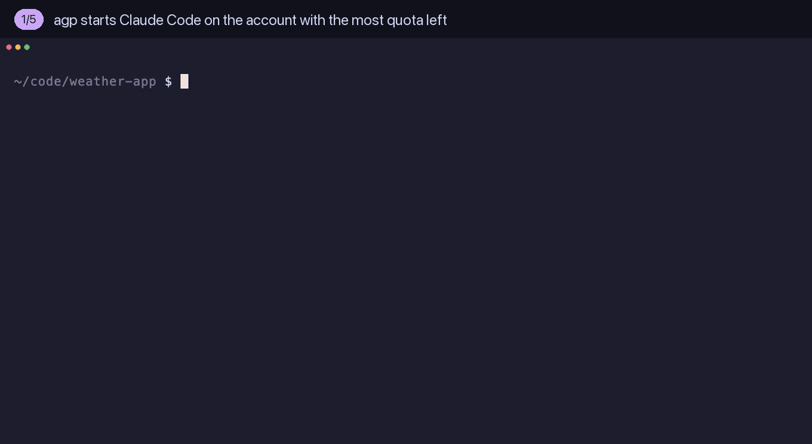
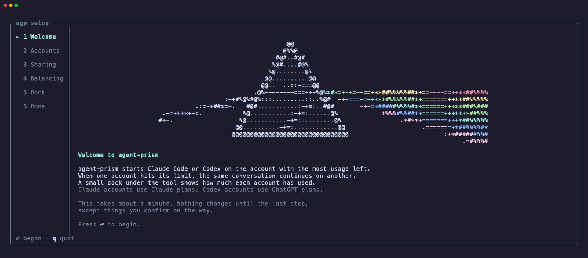
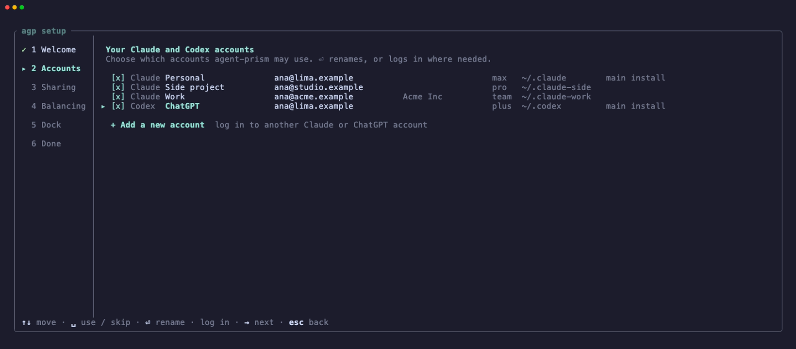
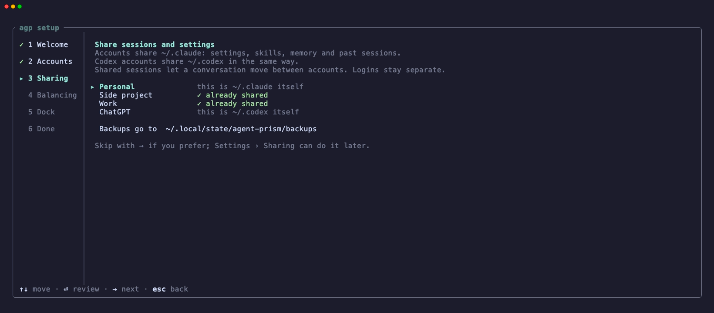
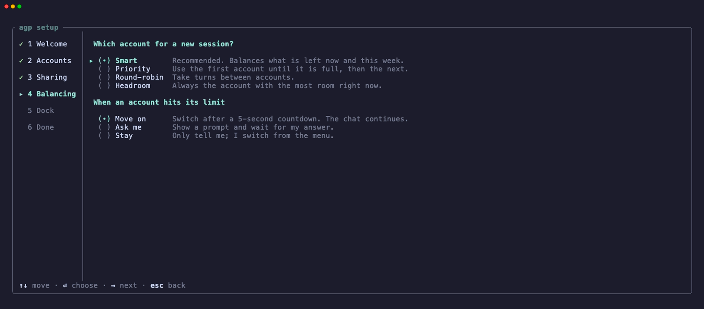
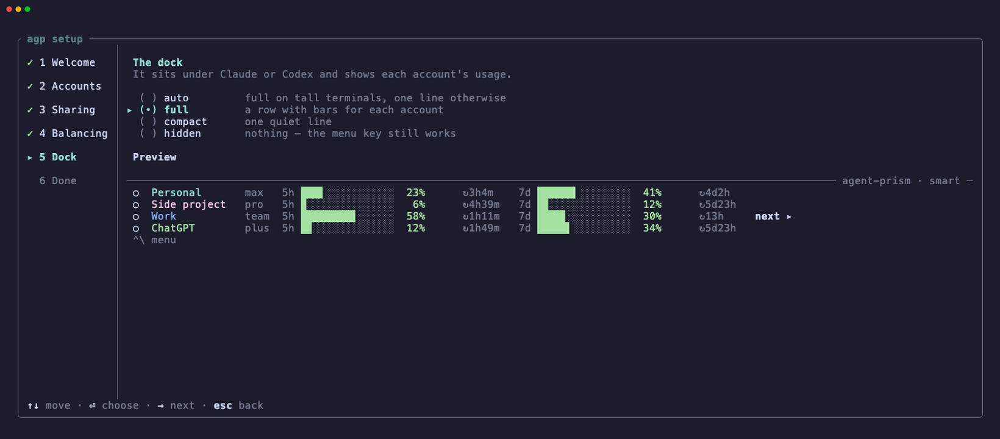
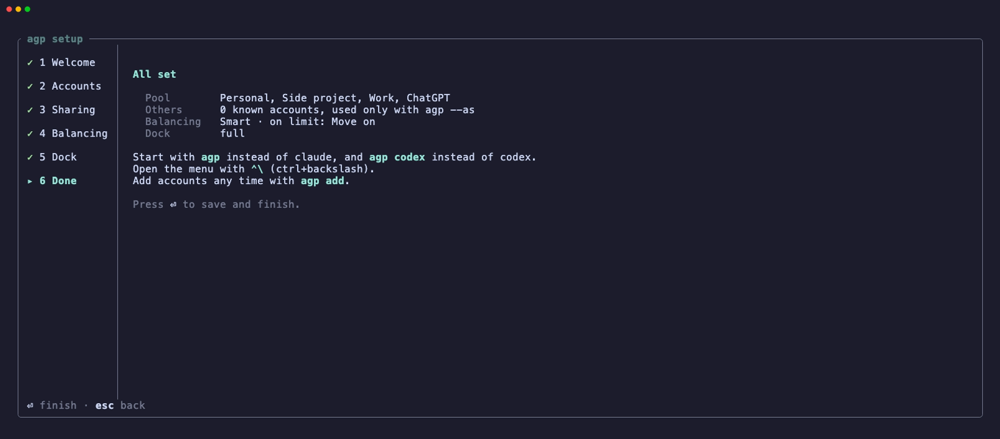
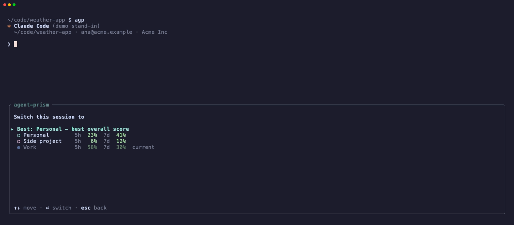
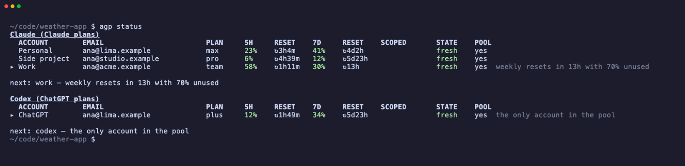

# agent-prism

`agp` starts Claude Code on the Claude account with the most usable quota,
and keeps a dock with the usage of all your accounts below the normal Claude
screen. When a limit stops the active account, agent-prism moves the same
conversation to the next account (`claude --resume`).

`agp codex` does the same for the Codex CLI with ChatGPT plans (Plus, Pro,
Business): it starts `codex` on the ChatGPT account with the most quota left
and resumes the thread on another account (`codex resume`). A session uses
the accounts of one tool only.

In scripts and CI, `agp` is a drop-in for `claude -p` and `codex exec`:
`agp -p "..."` and `agp codex exec "..."` run on the best account, with the
same args, stdin, stdout, stderr and exit code. See
[Drop-in for `claude -p` and `codex exec`](#drop-in-for-claude--p-and-codex-exec).

Platform: macOS only. agent-prism reads Claude logins from the macOS
Keychain.



The demo and the images below use fictional accounts and a stand-in for
`claude` ([demo/](demo/); `demo/record.sh` records them again).

## Install

Needs Rust 1.88 or later, and `claude` (or `codex`) on your PATH.

```sh
scripts/install.sh        # builds and installs ~/.local/bin/agp
```

Set `AGP_INSTALL_DIR` to install to a different directory.

## First run

The first `agp` starts a short setup. Nothing changes on disk until the last
step, except things that you confirm on the way.

<table>
  <tr>
    <td width="50%"><br>
      <b>1. Welcome.</b> What agent-prism does.</td>
    <td width="50%"><br>
      <b>2. Accounts.</b> agent-prism finds the Claude and Codex logins on
      this Mac. Choose the ones to use and give them short names.</td>
  </tr>
  <tr>
    <td><br>
      <b>3. Sharing.</b> Accounts share <code>~/.claude</code> (settings,
      skills, memory, sessions), so a conversation can move between them.
      Logins stay separate.</td>
    <td><br>
      <b>4. Balancing.</b> How to pick the account for a new session, and
      what to do when an account hits its limit.</td>
  </tr>
  <tr>
    <td><br>
      <b>5. Dock.</b> How the usage dock under Claude looks, with a
      preview.</td>
    <td><br>
      <b>6. Done.</b> A summary. Enter saves the config and starts
      Claude.</td>
  </tr>
</table>

## Use

```sh
agp                     # first run: onboarding; then Claude on the best account
agp --as personal       # pin an account for this session
agp -- --help           # claude flags pass through; agent-prism flags go first
agp -p "question"       # print mode: drop-in for claude -p on the best account
agp codex               # Codex on the best ChatGPT account
agp codex --as chatgpt  # Codex on one account; codex args follow as usual
agp codex exec "task"   # drop-in for codex exec on the best ChatGPT account
agp --bg "task"         # a Claude Code background session; limits handled
agp bg                  # background sessions agp watches (--json)
agp status              # usage table of all accounts (--json, --watch)
agp dashboard           # usage, history and runs in the browser
agp skill install       # teach Claude, Codex and other agents to use agp
agp skill list          # where the agp skill is installed, and if it is current
agp pick --codex        # the ChatGPT account a new session would use
agp pick --n 4          # where 4 new runs would go (each counts the ones before)
agp settings            # settings, full screen
agp add [id]            # add an account; asks Claude or Codex, then logs in
agp add --codex [id]    # add a ChatGPT account (creates ~/.codex-<id>)
agp adopt <id>          # show how a profile dir would share ~/.claude (--apply)
agp doctor              # health check
```

agent-prism flags (`--as`, `--policy`, `--dock` and the per-run options
below) only count before the claude (or codex) args.

## Drop-in for `claude -p` and `codex exec`

Put `agp` in front of a `claude` line, or replace `codex` with `agp codex`.
Nothing else in the line changes.

| Before | After |
| --- | --- |
| `claude -p "summarize the diff"` | `agp -p "summarize the diff"` |
| `git diff \| claude -p "review" --output-format json` | `git diff \| agp -p "review" --output-format json` |
| `codex exec "fix the failing test"` | `agp codex exec "fix the failing test"` |
| `codex exec --json - < prompt.md > out.jsonl` | `agp codex exec --json - < prompt.md > out.jsonl` |
| `codex exec resume --last "go on"` | `agp codex exec resume --last "go on"` |
| `codex review --uncommitted` | `agp codex review --uncommitted` |

For these lines agent-prism picks the account, sets its env, and then
replaces itself with `claude` or `codex` (the same process). There is no
dock and no wrapper in the pipe, so scripts, CI jobs and other agents get:

- the same args, in the same order
- the same stdin, stdout and stderr (agent-prism writes nothing to stdout)
- the same exit code.

agent-prism never prompts there. If it can't pick an account (no config, no
accounts, all accounts limited), it writes one line to stderr and runs the
tool anyway. Add `--as <id>` or `--policy <p>` before the tool args to
control the pick: `agp codex --as work exec "task"`.

`agp -p` (or `--print`) is Claude's print mode. For Codex, every line that
does not start the TUI runs this way: `exec` (`e`), `review`, `login`,
`mcp`, `--help` and the other subcommands, but not `resume` and `fork`.
All Codex accounts use one thread database, so `exec resume` finds a thread
that another account started.

## Parallel lanes

Start every lane without `--as`; agent-prism spreads them, even lanes started
in the same second:

```sh
agp status              # RUNS per account, and room for more runs
agp pick --n 3          # where 3 new runs would go
for t in api ui docs; do agp --on-limit switch -p "do the $t part" > "$t.md" & done; wait
```

- Every run holds a claim on its account while it runs: interactive
  sessions, `agp -p`, `agp codex exec`, supervised runs, `--bg` sessions,
  and runs pinned with `--as`. Picks are serialized (a file lock), so lanes
  that start together see each other.
- A working run counts as `balance.run_load` (default 25) percent of the 5h
  window per hour on a 5x/team plan (half that on 20x), on top of the
  account's measured use and its burn rate over the last hour (which also
  sees use from claude.ai or another machine). An interactive session that
  waits for you counts a quarter. With accounts at 10%, 30% and 40%, three
  lanes go a, b, a instead of a, a, a.
- `agp status --json` has `runs`, `load_5h` (expected 5h use one hour from
  now) and `usable` per account, and `capacity`: how many more runs fit
  before every account nears `soft_5h`.
- Moves on a limit are spread the same way.
- `agp -p` gives each Claude run a session id. A resume (`--resume <id>`,
  `-c`, `codex exec resume`) starts on the account that last ran that
  conversation, where its prompt cache is, if it is not limited and has room.
- `idle` in `agp status` (older versions: `expired`) means nothing used the
  account for hours, so its access token ran out. It is still logged in and
  usable; the next run there refreshes the token. Only `no login` needs a
  new login. To keep idle tokens fresh, set `[usage] token_refresh =
  "nudge"`: agent-prism then runs `claude mcp get <made-up name>` on an idle
  account now and then, which refreshes the token without a model call
  (needs your desktop session; it can't read the Keychain over SSH).

## Per-run options

These change one run and never the config. Like the other agent-prism flags
they go before the claude (or codex) args.

| Option | Effect |
| --- | --- |
| `--on-limit switch` | On a limit, move the conversation to the best other account (config: `auto`). |
| `--on-limit wait` | Keep the account, wait for its reset, then go on with the same conversation there. |
| `--on-limit stay` / `ask` | Only tell / ask first (as in the config). |
| `--on-limit fail` | `-p` and `codex exec` only: exit 75 instead of running or waiting on a limited account. |
| `--max-wait <dur>` | Wait at most this long for a reset (`90m`, `2h`, `1d`). Longer: `-p` exits 75, a session stays and tells you. |
| `--accounts <ids>` | Use only these accounts (comma-separated), in the pool or not. |
| `--exclude <ids>` | Never use these accounts. |
| `--max-usage <pct>` | An account at or over this 5h or weekly % counts as limited: it is not picked, and in a session reaching it is a limit. |

```sh
agp --on-limit wait --max-wait 6h -p "migrate the tests" --output-format json
agp --on-limit fail -p "review" > review.md   # 75: all usable accounts limited
agp --max-usage 70 --exclude personal -p "batch job"
agp codex --on-limit wait exec "fix the build"
agp --on-limit wait                           # a session that waits instead of moving
```

Without `--on-limit`, `agp -p` and `agp codex exec` replace themselves with
the tool as described above. With it, agent-prism stays the parent process
so it can act on a limit: it waits or moves, then resumes the conversation
(`claude -p --resume <id>`, `codex exec resume <id>`) with a one-line note
and `continue` (`balance.resume_prompt`). stdin goes to the first attempt;
the stdout of an attempt that a limit stopped is dropped, so a script gets
only the final answer, except `--output-format stream-json` and
`codex exec --json`, which stream. The exit code is the last attempt's, or
75 (`EX_TEMPFAIL`) when agent-prism gives up on a limit. Ctrl+C and
`SIGTERM` go to the tool; during a wait they end agent-prism.

What a script gets after a resume: the same conversation (same session id),
so Claude has the whole task in context and goes on where it stopped, but
the final output is its reply to the resume note. With
`--output-format json`, `result`, `total_cost_usd`, `usage` and `num_turns`
cover the last attempt only. A wait can take hours (cap it with
`--max-wait`). Claude Code itself does not wait for a usage limit: in `-p`
it exits with an error (it only retries short API errors), so without
`--on-limit` that error is what the script gets.

`wait` is also a config value (`balance.on_limit = "wait"`, in
`agp settings` → Balancing).

## Background sessions (`claude --bg`)

`agp` in front of a `claude --bg` line starts the background session on
the best account, and leaves a small watcher that handles its limits:

```sh
agp --bg --name fix-auth "fix the auth bug"
agp --as work --on-limit wait -- --bg --name nightly "run the migration"
agp bg                        # the sessions agp watches, their account and state
agp bg --json                 # the same as JSON (for scripts and orchestrators)
agp bg watch f1de9de1         # watch a session agp did not start (or around claude respawn)
agp bg move f1de9de1 --to b   # move a session to another account now
```

The launch is a drop-in: same args, stdin, stdout, stderr and exit code;
agp exits as soon as `claude --bg` does. Claude Code leaves a session that
hits its account's limit blocked until someone acts; the watcher (a
detached process, one per session) sees the limit in the job's
`state.json` and then:

- `--on-limit switch` (the default with `on_limit = "auto"`): stops the
  session and resumes the same conversation on the best other account,
  with a one-line note and `continue`. With no free account it waits.
- `--on-limit wait`: waits for the reset, then wakes the session on the
  same account (at most `--max-wait`).
- `--on-limit stay` (and `fail`): no watcher.

Moves need shared `projects/` (`agp adopt`) and a trusted folder in the
target account (agp copies folder trust). agp never deletes a job: after a
move the old account keeps the stopped job, because the session still uses
its worktree. `--accounts`, `--exclude`, `--max-usage` and `--policy`
apply to the first pick and to every move. When agp merges settings into
your `--settings` file it passes a file of its own that it writes again
from yours on every move and on `agp bg watch`, so rewrite your file and
run `agp bg watch <id>` before a `claude respawn` to give the session new
hooks.

## Skills for agents

agp ships an Agent Skill, `agp`, that teaches coding agents to run Claude
Code and Codex through agp. With it an agent:

- puts `agp` in front of `claude -p`, `claude --bg` and `codex exec`
- starts parallel lanes without `--as`, so agp spreads them, and checks
  `capacity` in `agp status --json` before a big fan-out
- uses `--on-limit`, `--max-wait` and `agp --bg` for long runs, and knows
  that exit code 75 means "limited, retry later"
- continues a conversation with `agp -p --resume <session_id>`
- reads `agp status`: an `idle` (or `expired`) account is still logged in;
  only `no login` needs you
- leaves `agp settings`, `agp setup`, `agp add` and `agp adopt --apply` to
  you.

The skill is a folder: a short `SKILL.md` and `reference/` pages for
lanes, background sessions and status. The text is built into `agp`, so an
install always matches the binary.

```sh
agp skill install                  # every agent found on this Mac
agp skill install --agent gemini   # only these (repeat it or use a,b)
agp skill install --dir ~/my-agent/skills   # any Agent Skills folder: <dir>/agp
agp skill list                     # each target, and whether its copy is current
agp skill                          # print SKILL.md
agp skill uninstall                # remove the copies agp installed (--agent, --dir)
```

Each target prints `installed`, `updated` or `up to date` and the path.

| Agent | `--agent` | Where the skill lands | By default |
| --- | --- | --- | --- |
| Claude Code | `claude` | `~/.claude/skills/agp` (the common home, `common_home`) | yes |
| Codex CLI | `codex` | `~/.codex/skills/agp` (`codex.common_home`) | yes |
| Gemini CLI | `gemini` | `~/.gemini/skills/agp` | when `~/.gemini` exists |
| GitHub Copilot CLI | `copilot` | `~/.copilot/skills/agp` | when `~/.copilot` exists |
| Factory Droid | `droid` | `~/.factory/skills/agp` | when `~/.factory` exists |
| Amp, OpenCode, Cursor, Goose | `amp`, `opencode`, `cursor`, `goose` | they read `~/.claude/skills`, so the Claude copy serves them | with Claude |
| Agents that read `~/.agents/skills` | `agents` | `~/.agents/skills/agp` | only with `--agent agents` |
| Any other agent | `--dir <skills dir>` | `<skills dir>/agp` | no |

All accounts of a tool share its common home, so every Claude and Codex
account sees the skill. agp installs one copy per folder an agent reads:
Codex also reads `~/.agents/skills`, so a copy there too (`--agent
agents`) shows the skill twice in Codex. Use it for an agent that reads
only `~/.agents/skills`.

agp writes `.agp-skill.json` into the folder it installs, with the list of
its files. It updates, prunes and removes only a folder with that file (or
the one-file `SKILL.md` an older agp wrote), and only the files on that
list. A `<skills dir>/agp` that agp did not install, or a symlink to a
folder agp does not manage, is reported and left alone.

**Update.** Run `agp skill install` again after you upgrade agp. It
rewrites what changed and removes files an older version wrote that the
skill no longer has; `up to date` means nothing changed.

**Manual install.** Copy the folder
[`crates/agent-prism/skills/agp`](crates/agent-prism/skills/agp) into the
agent's skills folder as `agp`, or run `agp skill install --dir <skills
dir>`. A manual copy has no `.agp-skill.json`, so `agp skill` won't touch
it: delete it yourself, or remove it once and let `agp skill install`
manage the folder.

**Uninstall.** `agp skill uninstall` removes agp's files from every
target (`--agent`, `--dir` for some). Files you added to the folder stay.

## Dashboard

`agp dashboard` serves a usage dashboard on `127.0.0.1` and opens it in the
browser (`--port <n>` picks the port, `--no-open` only prints the URL;
Ctrl+C stops it). It shows:

- every account now: 5-hour and weekly use with reset countdowns and the
  projected use at reset, limited, stale or expired logins, live sessions,
  and the account the next session of each tool goes to, with the reason
- the use of each account over the last 24 hours or 7 days, with the limit
  hits marked
- a timeline of runs per account, with switches and limit hits
- run time, runs and tokens by account, project, mode (interactive or
  scripted) and model, and when in the week the agents run
- a feed of limits, waits and switches, and a table of runs.

Runs come from the run journal (`~/.local/state/agent-prism/runs.jsonl`).
Token counts come from the Claude transcripts and Codex rollout files of
the sessions in the journal; agent-prism reads only those files. While the
dashboard runs, it refreshes the usage of every account every
`usage.poll_idle_secs`. The page works offline, answers only requests to
`127.0.0.1`, `localhost` or an `--allow-host` name, and never shows a token.

To open it from your other devices over Tailscale, put `tailscale serve`
in front and allow the name it forwards:

```sh
agp dashboard --port 8787 --no-open --allow-host <host>.<tailnet>.ts.net
tailscale serve --bg 8787
```

## In a session

In a session, `⌃\` opens the menu: switch account now, settings, accounts,
refresh usage, dock mode, log. Press `⌃\` twice to send `⌃\` to Claude
(or Codex).

<table>
  <tr>
    <td width="50%"><br>
      <b>Switch account now.</b> Move the conversation to another account
      at any time.</td>
    <td width="50%"><br>
      <b><code>agp status</code>.</b> The usage of all accounts, and the
      account that a new session would use.</td>
  </tr>
</table>

## How it works

- Each account is a Claude config dir (`~/.claude-<id>`). Shared parts
  (CLAUDE.md, settings, agents, skills, hooks, plugins, projects, history …)
  are symlinks into `~/.claude`; account parts (`.claude.json`, credentials,
  daemon, caches) stay in the dir. `agp adopt` sets this up with a backup
  first.
- Usage comes from the same endpoint Claude Code uses, with each account's
  token from the Keychain. agent-prism never prints or stores tokens and never
  writes to the Keychain.
- agent-prism points Claude's auto memory at the real `~/.claude/projects/...`
  path, so memory writes through the shared symlink don't prompt.
- agent-prism adds its hooks with `claude --settings`; your `settings.json` does
  not change.
- A folder you trust on one Claude account is trusted on all of them:
  before Claude starts, agent-prism adds the other accounts' trusted folders
  to that account's `.claude.json` (it never removes trust). Turn it off with
  `[share] sync_trust = false`.
- Settings stay shared. Some of Claude's settings writes replace an
  account's `settings.json` link with a file of its own, so a setting
  saved there (an effort, a model) stays in that account. Before Claude
  starts, agent-prism merges such a file back into `~/.claude/settings.json`
  and links it again (the files it replaces are kept in
  `~/.local/state/agent-prism/settings-sync/`). A copy that drifted before
  agent-prism first saw the account linked is left alone; `agp doctor` shows
  what differs and how to link it. Turn it off with
  `[share] sync_settings = false`.
- A switch keeps the session's effort: an effort chosen with `/effort`
  comes back as `--effort` when Claude restarts on the other account.
- A Codex account is a `CODEX_HOME` dir (`~/.codex-<id>`). Its login
  (`auth.json`) stays in the dir; `config.toml`, `AGENTS.md`, skills,
  prompts, memories and the session files are symlinks into `~/.codex`.
  All accounts use the thread database in `~/.codex` (`sqlite_home`), and
  agent-prism starts Codex with `--no-daemon`, so each account uses its own login.
  Usage comes from the endpoint behind Codex's `/status`. agent-prism finds the
  thread id in Codex's database (read-only).

Config: `~/.config/agent-prism/config.toml`. State and logs: `~/.local/state/agent-prism/`.
Design: [docs/DESIGN.md](docs/DESIGN.md).

## Caveats

- agent-prism is not affiliated with Anthropic or OpenAI.
- The usage numbers come from endpoints that Claude Code and Codex use
  internally. They are not documented, and they can change or stop working
  at any time.
- Use only accounts that you are allowed to use, and follow the terms of
  your Claude and ChatGPT plans.

## License

MIT. See [LICENSE](LICENSE).
