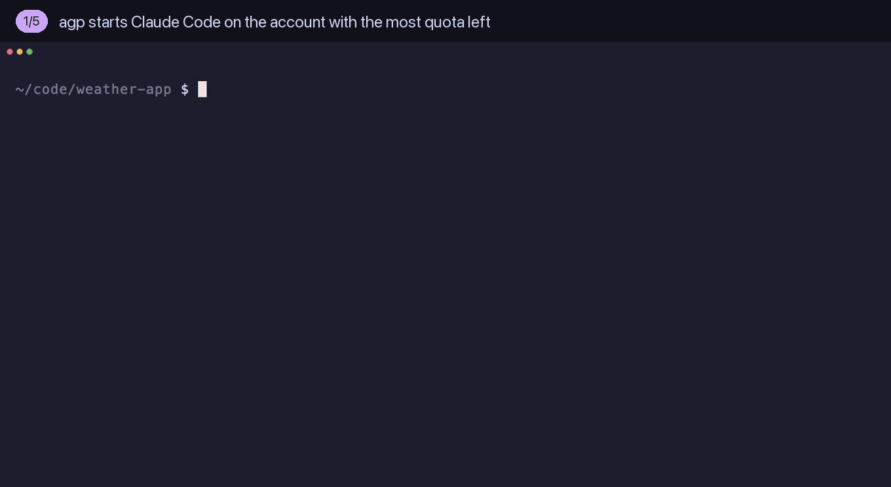
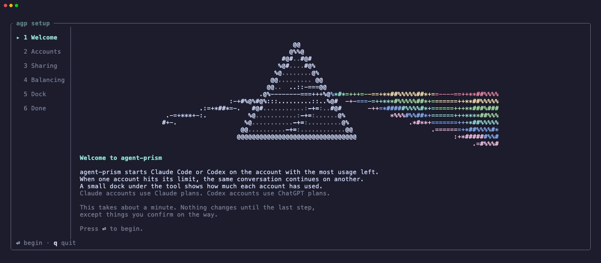
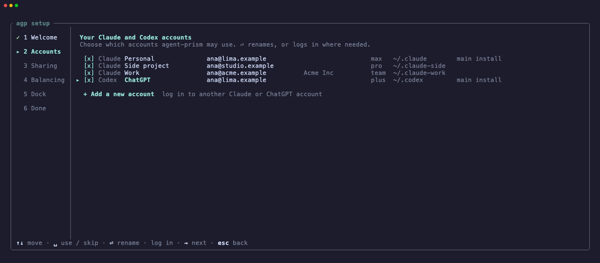
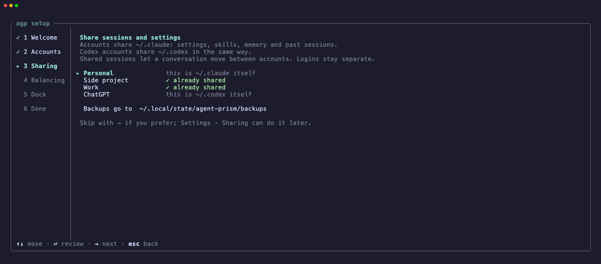
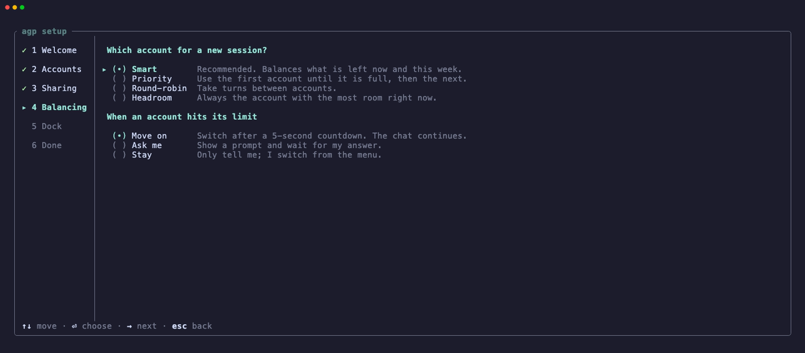
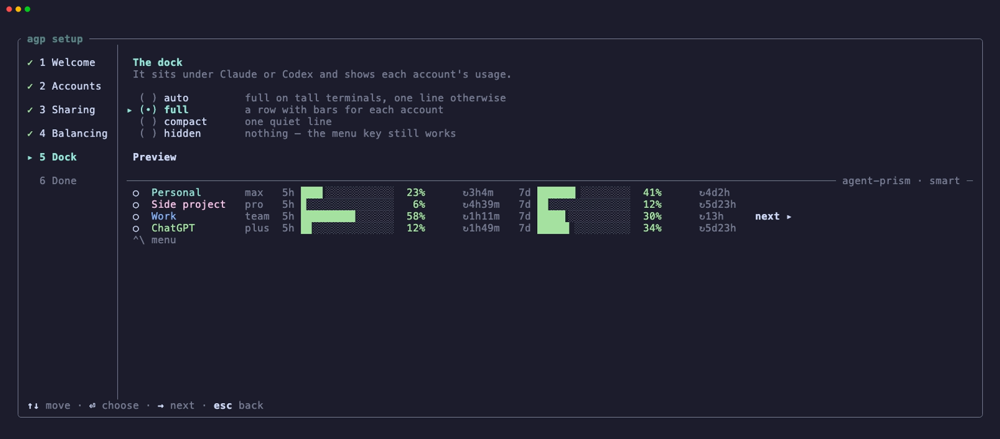
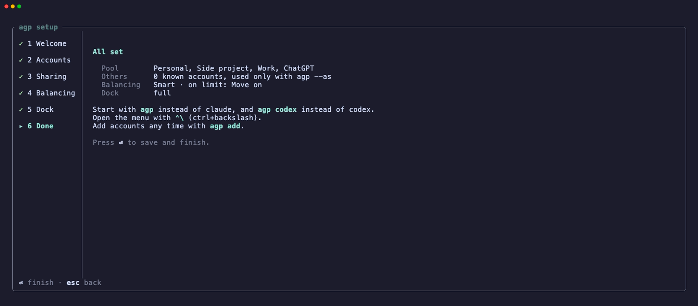
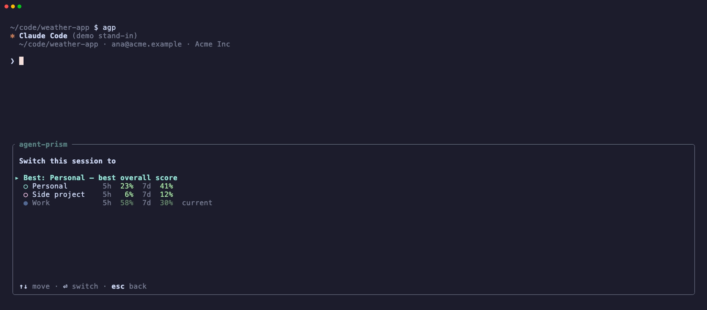
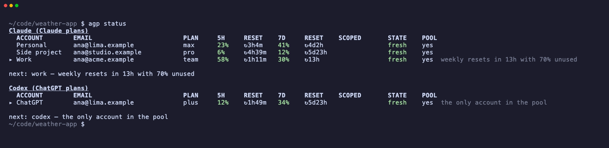

# agent-prism

`agp` starts Claude Code on the Claude account with the most usable quota,
and keeps a dock with the usage of all your accounts below the normal Claude
screen. When a limit stops the active account, agent-prism moves the same
conversation to the next account (`claude --resume`).

`agp codex` does the same for the Codex CLI with ChatGPT plans (Plus, Pro,
Business): it starts `codex` on the ChatGPT account with the most quota left
and resumes the thread on another account (`codex resume`). A session uses
the accounts of one tool only.

In scripts and CI, `agp` is a drop-in for `claude -p` and `codex exec`:
`agp -p "..."` and `agp codex exec "..."` run on the best account, with the
same args, stdin, stdout, stderr and exit code. See
[Drop-in for `claude -p` and `codex exec`](#drop-in-for-claude--p-and-codex-exec).

Platform: macOS only. agent-prism reads Claude logins from the macOS
Keychain.



The demo and the images below use fictional accounts and a stand-in for
`claude` ([demo/](demo/); `demo/record.sh` records them again).

## Install

Needs Rust 1.88 or later, and `claude` (or `codex`) on your PATH.

```sh
scripts/install.sh        # builds and installs ~/.local/bin/agp
```

Set `AGP_INSTALL_DIR` to install to a different directory.

## First run

The first `agp` starts a short setup. Nothing changes on disk until the last
step, except things that you confirm on the way.

<table>
  <tr>
    <td width="50%"><br>
      <b>1. Welcome.</b> What agent-prism does.</td>
    <td width="50%"><br>
      <b>2. Accounts.</b> agent-prism finds the Claude and Codex logins on
      this Mac. Choose the ones to use and give them short names.</td>
  </tr>
  <tr>
    <td><br>
      <b>3. Sharing.</b> Accounts share <code>~/.claude</code> (settings,
      skills, memory, sessions), so a conversation can move between them.
      Logins stay separate.</td>
    <td><br>
      <b>4. Balancing.</b> How to pick the account for a new session, and
      what to do when an account hits its limit.</td>
  </tr>
  <tr>
    <td><br>
      <b>5. Dock.</b> How the usage dock under Claude looks, with a
      preview.</td>
    <td><br>
      <b>6. Done.</b> A summary. Enter saves the config and starts
      Claude.</td>
  </tr>
</table>

## Use

```sh
agp                     # first run: onboarding; then Claude on the best account
agp --as personal       # pin an account for this session
agp -- --help           # claude flags pass through; agent-prism flags go first
agp -p "question"       # print mode: drop-in for claude -p on the best account
agp codex               # Codex on the best ChatGPT account
agp codex --as chatgpt  # Codex on one account; codex args follow as usual
agp codex exec "task"   # drop-in for codex exec on the best ChatGPT account
agp status              # usage table of all accounts (--json, --watch)
agp dashboard           # usage, history and runs in the browser
agp skill install       # teach Claude and Codex agents to use agp
agp pick --codex        # the ChatGPT account a new session would use
agp settings            # settings, full screen
agp add [id]            # add an account; asks Claude or Codex, then logs in
agp add --codex [id]    # add a ChatGPT account (creates ~/.codex-<id>)
agp adopt <id>          # show how a profile dir would share ~/.claude (--apply)
agp doctor              # health check
```

agent-prism flags (`--as`, `--policy`, `--dock` and the per-run options
below) only count before the claude (or codex) args.

## Drop-in for `claude -p` and `codex exec`

Put `agp` in front of a `claude` line, or replace `codex` with `agp codex`.
Nothing else in the line changes.

| Before | After |
| --- | --- |
| `claude -p "summarize the diff"` | `agp -p "summarize the diff"` |
| `git diff \| claude -p "review" --output-format json` | `git diff \| agp -p "review" --output-format json` |
| `codex exec "fix the failing test"` | `agp codex exec "fix the failing test"` |
| `codex exec --json - < prompt.md > out.jsonl` | `agp codex exec --json - < prompt.md > out.jsonl` |
| `codex exec resume --last "go on"` | `agp codex exec resume --last "go on"` |
| `codex review --uncommitted` | `agp codex review --uncommitted` |

For these lines agent-prism picks the account, sets its env, and then
replaces itself with `claude` or `codex` (the same process). There is no
dock and no wrapper in the pipe, so scripts, CI jobs and other agents get:

- the same args, in the same order
- the same stdin, stdout and stderr (agent-prism writes nothing to stdout)
- the same exit code.

agent-prism never prompts there. If it can't pick an account (no config, no
accounts, all accounts limited), it writes one line to stderr and runs the
tool anyway. Add `--as <id>` or `--policy <p>` before the tool args to
control the pick: `agp codex --as work exec "task"`.

`agp -p` (or `--print`) is Claude's print mode. For Codex, every line that
does not start the TUI runs this way: `exec` (`e`), `review`, `login`,
`mcp`, `--help` and the other subcommands, but not `resume` and `fork`.
All Codex accounts use one thread database, so `exec resume` finds a thread
that another account started.

## Per-run options

These change one run and never the config. Like the other agent-prism flags
they go before the claude (or codex) args.

| Option | Effect |
| --- | --- |
| `--on-limit switch` | On a limit, move the conversation to the best other account (config: `auto`). |
| `--on-limit wait` | Keep the account, wait for its reset, then go on with the same conversation there. |
| `--on-limit stay` / `ask` | Only tell / ask first (as in the config). |
| `--on-limit fail` | `-p` and `codex exec` only: exit 75 instead of running or waiting on a limited account. |
| `--max-wait <dur>` | Wait at most this long for a reset (`90m`, `2h`, `1d`). Longer: `-p` exits 75, a session stays and tells you. |
| `--accounts <ids>` | Use only these accounts (comma-separated), in the pool or not. |
| `--exclude <ids>` | Never use these accounts. |
| `--max-usage <pct>` | An account at or over this 5h or weekly % counts as limited: it is not picked, and in a session reaching it is a limit. |

```sh
agp --on-limit wait --max-wait 6h -p "migrate the tests" --output-format json
agp --on-limit fail -p "review" > review.md   # 75: all usable accounts limited
agp --max-usage 70 --exclude personal -p "batch job"
agp codex --on-limit wait exec "fix the build"
agp --on-limit wait                           # a session that waits instead of moving
```

Without `--on-limit`, `agp -p` and `agp codex exec` replace themselves with
the tool as described above. With it, agent-prism stays the parent process
so it can act on a limit: it waits or moves, then resumes the conversation
(`claude -p --resume <id>`, `codex exec resume <id>`) with a one-line note
and `continue` (`balance.resume_prompt`). stdin goes to the first attempt;
the stdout of an attempt that a limit stopped is dropped, so a script gets
only the final answer, except `--output-format stream-json` and
`codex exec --json`, which stream. The exit code is the last attempt's, or
75 (`EX_TEMPFAIL`) when agent-prism gives up on a limit. Ctrl+C and
`SIGTERM` go to the tool; during a wait they end agent-prism.

What a script gets after a resume: the same conversation (same session id),
so Claude has the whole task in context and goes on where it stopped, but
the final output is its reply to the resume note. With
`--output-format json`, `result`, `total_cost_usd`, `usage` and `num_turns`
cover the last attempt only. A wait can take hours (cap it with
`--max-wait`). Claude Code itself does not wait for a usage limit: in `-p`
it exits with an error (it only retries short API errors), so without
`--on-limit` that error is what the script gets.

`wait` is also a config value (`balance.on_limit = "wait"`, in
`agp settings` → Balancing).

## Agents: the agp skill

`agp skill install` writes an `agp` skill to `~/.claude/skills/agp` and
`~/.codex/skills/agp`. All accounts of a tool share that dir, so every
Claude and Codex agent knows to use `agp -p` / `agp codex exec`, the
per-run options and `agp status` without finding them out again. Run it
again after an update (it says "up to date" when nothing changed);
`agp skill` prints the text.

## Dashboard

`agp dashboard` serves a usage dashboard on `127.0.0.1` and opens it in the
browser (`--port <n>` picks the port, `--no-open` only prints the URL;
Ctrl+C stops it). It shows:

- every account now: 5-hour and weekly use with reset countdowns and the
  projected use at reset, limited, stale or expired logins, live sessions,
  and the account the next session of each tool goes to, with the reason
- the use of each account over the last 24 hours or 7 days, with the limit
  hits marked
- a timeline of runs per account, with switches and limit hits
- run time, runs and tokens by account, project, mode (interactive or
  scripted) and model, and when in the week the agents run
- a feed of limits, waits and switches, and a table of runs.

Runs come from the run journal (`~/.local/state/agent-prism/runs.jsonl`).
Token counts come from the Claude transcripts and Codex rollout files of
the sessions in the journal; agent-prism reads only those files. While the
dashboard runs, it refreshes the usage of every account every
`usage.poll_idle_secs`. The page works offline, answers only requests to
`127.0.0.1` or `localhost`, and never shows a token.

## In a session

In a session, `⌃\` opens the menu: switch account now, settings, accounts,
refresh usage, dock mode, log. Press `⌃\` twice to send `⌃\` to Claude
(or Codex).

<table>
  <tr>
    <td width="50%"><br>
      <b>Switch account now.</b> Move the conversation to another account
      at any time.</td>
    <td width="50%"><br>
      <b><code>agp status</code>.</b> The usage of all accounts, and the
      account that a new session would use.</td>
  </tr>
</table>

## How it works

- Each account is a Claude config dir (`~/.claude-<id>`). Shared parts
  (CLAUDE.md, settings, agents, skills, hooks, plugins, projects, history …)
  are symlinks into `~/.claude`; account parts (`.claude.json`, credentials,
  daemon, caches) stay in the dir. `agp adopt` sets this up with a backup
  first.
- Usage comes from the same endpoint Claude Code uses, with each account's
  token from the Keychain. agent-prism never prints or stores tokens and never
  writes to the Keychain.
- agent-prism points Claude's auto memory at the real `~/.claude/projects/...`
  path, so memory writes through the shared symlink don't prompt.
- agent-prism adds its hooks with `claude --settings`; your `settings.json` does
  not change.
- A folder you trust on one Claude account is trusted on all of them:
  before Claude starts, agent-prism adds the other accounts' trusted folders
  to that account's `.claude.json` (it never removes trust). Turn it off with
  `[share] sync_trust = false`.
- A Codex account is a `CODEX_HOME` dir (`~/.codex-<id>`). Its login
  (`auth.json`) stays in the dir; `config.toml`, `AGENTS.md`, skills,
  prompts, memories and the session files are symlinks into `~/.codex`.
  All accounts use the thread database in `~/.codex` (`sqlite_home`), and
  agent-prism starts Codex with `--no-daemon`, so each account uses its own login.
  Usage comes from the endpoint behind Codex's `/status`. agent-prism finds the
  thread id in Codex's database (read-only).

Config: `~/.config/agent-prism/config.toml`. State and logs: `~/.local/state/agent-prism/`.
Design: [docs/DESIGN.md](docs/DESIGN.md).

## Caveats

- agent-prism is not affiliated with Anthropic or OpenAI.
- The usage numbers come from endpoints that Claude Code and Codex use
  internally. They are not documented, and they can change or stop working
  at any time.
- Use only accounts that you are allowed to use, and follow the terms of
  your Claude and ChatGPT plans.

## License

MIT. See [LICENSE](LICENSE).
